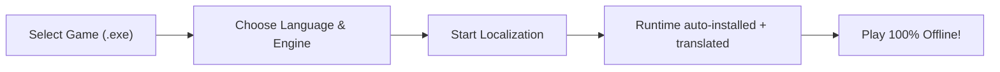

# UnityLocalizer 🎮🌐

[](LICENSE)
[](https://www.python.org/)
[](https://github.com)
[](https://www.riverbankcomputing.com/software/pyqt/)
[](https://github.com/YourUsername/UnityLocalizer/actions)

> **High-performance, automated, ahead-of-time (AOT) translation and patch deployment suite for games built on the Unity engine.**

Translate any Unity game into your native language with zero gameplay lag, complete offline runtime playback, and automatic TextMeshPro "tofu" (missing glyph) font resolution.

---

[📖 English Description](#-key-features) | [🇹🇷 Türkçe Açıklama](#-t%C3%BCrk%C3%A7e-%C3%B6zet)

---

## ⚡ Why UnityLocalizer?

Most real-time machine translation tools hook into games and translate text line-by-line while you play. This causes **network latency, stuttering, broken formatting, and missing font characters (□ squares)**. 

**UnityLocalizer does things differently:**
- 🚀 **100% Offline In-Game Performance:** Translates your game **ahead-of-time (AOT)**. Once localized, play completely offline with zero FPS drop or lag.
- 🛡️ **Zero Crash Risk:** Uses read-only binary extraction (`UnityPy`) instead of dangerous binary asset repacking that breaks modern Unity LZ4/LZMA checksums.
- 🔡 **Advanced Font Management:** Solves missing glyphs across both legacy uGUI (`UnityEngine.UI.Text`) and TextMeshPro. Supports version-matched ArialUnicode SDF fallback bundles, system font overrides, and custom `.ttf`/`.otf` font file injection directly from the Toolbox. Automatically configures reliable OS TrueType fonts on IL2CPP / Unity 6 builds to avoid stripped runtime crashes.
- 🎯 **Dynamic Choice & Prefix Matching:** Automatically generates regex rules for numbered options (`1. `, `[1] `) and CRPG skill check tags (`[Charm] `, `[Strength] `), translating dynamic dialogue choice buttons seamlessly.
- 📖 **Bilingual Translation Mode:** Play games with dual-language display (`{target}\n({source})`), perfect for language learners and quality assurance reviewers.
- ⚡ **Zero-Latency In-Memory Regex Caching:** Uses `CacheRegexPatternResults` and `_Substitutions.txt` glossary integration to ensure butter-smooth 60+ FPS without micro-stutters.
- 🧩 **Automatic Source-Language Detection:** Leave the source language on *Auto-detect* and UnityLocalizer identifies the game's language before translating (Unicode script analysis, an offline `py3langid` model, then a Google vote for keyless engines) so Chinese, Japanese, Korean or Russian games work out of the box. You get a notification with the result, or a warning when it could not decide.
- 🧩 **AST Syntax Guard:** Protects RichText tags (`<color>`, `<size>`, `<sprite>`), NGUI BBCode, and C# formatting patterns (`{0}`, `{playerName}`, `\n`, `%s`) so game scripts never crash.
- 📦 **One-Click Standalone Patch Packages:** Export full, shareable offline patch `.zip` distributions with bilingual install and restore scripts for both Windows (`.bat`) and Linux / Steam Deck (`.sh`).

---

## 🎮 Quick Start Guide (For Gamers & Translators)

You don't need any modding experience to localize a Unity game:



### 3 Easy Steps:

1. **Select Your Game:**
   - Launch **UnityLocalizer**.
   - Drag & drop or browse to your game's root folder or `.exe`.
   - The profiler will instantly detect the Unity engine version, architecture (Mono vs. IL2CPP, 32-bit vs. 64-bit), and narrative frameworks.
2. **Choose Language & Engine:**
   - Pick your **Target Language** (the source language is detected automatically) and a **Translation Engine**.
   - There is nothing to install by hand: the matching BepInEx + XUnity runtime and font are downloaded (SHA256-verified) and set up automatically when you start.
3. **Translate & Play:**
   - Select your desired **Target Language** (e.g., Turkish, Spanish, German, French, etc.) and your preferred **Translation Engine**.
   - Click **"Start Localization"**. Warnings (unreadable files, missing runtime log, glyph coverage...) appear on the Dashboard, not only in the log.
   - Translation happens **before** you play: the finished dictionary is loaded offline by the game (no network, no live translation).
   - Once completed, click **Launch Game** and enjoy!

---

## ✨ Core Features

| Feature | Description |
| :--- | :--- |
| **Deep Multi-Channel Extraction** | Extracts player-visible text from `.assets`, `level*`, `data.unity3d`, Mono assemblies (`Assembly-CSharp.dll` `#US` stream), IL2CPP `global-metadata.dat`, and loose `StreamingAssets` (JSON, CSV, TSV, XML, TXT, Yarn Spinner, Inkle Ink, Naninovel). |
| **8 Translation Engines** | Multi-mirror Google Translate (13 mirrors with Lingva fallback), keyless Bing, DeepL (Free & Pro), LibreTranslate, Google Gemini (`google-genai`), OpenAI, DeepSeek, and Local LLMs (Ollama, LM Studio). |
| **Dynamic Regex Dictionaries** | Automatically synthesizes `.NET` regex dictionary entries (`r:"^Gold: (.*?)$"="Altın: ${1}"`) for runtime-formatted strings like `Gold: {0}`. |
| **Interactive Review Editor** | Filter, review, and manually tweak translated lines with real-time Syntax Guard validation before shipping. |
| **Glossary & Translation Memory** | Define custom term replacements (e.g., `Health Potion → Can İksiri`) and import existing TMX, CSV, TSV, or JSON translation memories with fuzzy matching. |
| **Full RTL Language Engine** | Native static shaping and tag-safe bidirectional reordering for Arabic, Persian, Hebrew, Urdu, Pashto, Sorani, Sindhi, Uyghur, Yiddish, and Dhivehi. |
| **Cyberpunk Glassmorphic UI** | Responsive, hardware-accelerated PyQt6 + QML interface localized into 12 languages with real-time log streaming and instant settings persistence. |

---

## 🛠️ Supported Translation Engines

| Engine | Type | API Key Required? | Concurrency / Features |
| :--- | :--- | :---: | :--- |
| **Google Translate** | Web Scraper | ❌ No | 13 endpoints, `batchexecute`, IP circuit breaker, Lingva fallback |
| **Microsoft Bing** | Web Scraper | ❌ No | Keyless Edge service with exponential backoff & Google failover |
| **DeepL** | Official API | ✔️ Yes (Free/Pro) | Formality control (`formal`, `informal`, `default`) |
| **LibreTranslate** | Self-Hosted / Public | Optional | Open-source API compatibility with request pacing |
| **Google Gemini** | AI (LLM) | ✔️ Yes | Official `google-genai` SDK, XML structured batching, safety filters |
| **OpenAI / OpenRouter** | AI (LLM) | ✔️ Yes | GPT-4o, custom OpenAI-compatible endpoints, XML batching |
| **DeepSeek** | AI (LLM) | ✔️ Yes | DeepSeek Chat & Reasoner with specialized system prompting |
| **Local LLM** | Self-Hosted | ❌ No | Ollama & LM Studio integration running 100% locally on your GPU |

---

## 📦 Standalone Patch Exporter

Want to share your localized game with friends or the community?
1. Open the **Dashboard** and click **Export Patch Package**.
2. UnityLocalizer generates a clean, standalone distribution in `%APPDATA%\UnityLocalizer\Patches\`:
   - `Patches/<Game>_<Language>_Patch.zip`
   - Includes automatic installer & uninstaller scripts: `Install_Patch.bat` (`Yama_Kur.bat`) and `Uninstall_Patch.bat` (`Yama_Kaldir.bat`).
3. Players simply extract the ZIP into the game folder, double-click **Install**, and the patch automatically backs up original game files (`.ul_orig`) and installs the translation. Running **Uninstall** restores the pristine vanilla state!

---

## 🩺 Troubleshooting & FAQ

<details>
<summary><b>Missing letters or box squares (□) appearing in-game?</b></summary>

This happens when the game's TextMeshPro font lacks glyphs for your language. UnityLocalizer handles it automatically: Mono games get a fallback font bundle, IL2CPP games (which cannot load AssetBundles) get an installed system font such as Arial added as a **fallback** for the missing characters only.

If boxes remain:
1. Open **Settings** in UnityLocalizer.
2. Under **Runtime & Font**, find **System font for TextMeshPro (optional)**.
3. Type the name of another installed font (e.g. `Segoe UI`, `Tahoma`).
4. Re-run the translation or use the Toolbox font button, then restart the game.

The tool never uses XUnity's `OverrideFontTextMeshPro` on IL2CPP: it crashed a Unity 6 game.
</details>

<details>
<summary><b>How do I toggle translations on/off while playing?</b></summary>

- `ALT + T`: Toggle translation on/off in real-time.
- `ALT + R`: Reload translation dictionaries without restarting the game.
</details>

<details>
<summary><b>Is Linux / Steam Deck / macOS supported?</b></summary>

- **Windows games on Steam Deck / Linux (Proton / Wine):** Supported. Every exported patch package includes `Install_Patch.sh`, `Uninstall_Patch.sh`, `Yama_Kur.sh` and `Yama_Kaldir.sh`. Add `WINEDLLOVERRIDES="winhttp=n,b" %command%` to the Steam launch options; UnityLocalizer shows this hint on the Dashboard when it runs on Linux.
- **Native Linux Unity builds (experimental):** UnityLocalizer detects `.x86_64` / ELF builds and installs the Linux BepInEx package (`run_bepinex.sh`, launch option `./run_bepinex.sh %command%`). This path has been verified only up to the package download and checksums, not on a real Linux machine yet; please report problems.
- **macOS:** not supported yet.
- **Known limits of native Linux games:** the game must start through `run_bepinex.sh` (Steam launch option `./run_bepinex.sh %command%`); games that launch through their own shell-script wrapper or a renamed executable can fail to load BepInEx (see the BepInEx issue tracker), and a Steam update can change the launch behaviour. The Translation font is chosen from the fonts installed on this machine (DejaVu Sans, Liberation Sans, Noto Sans, Noto Sans CJK ...); a missing glyph on another machine needs one of those fonts installed there. 32-bit IL2CPP builds are not supported on Linux.
- **Starting the game from the app:** a native Linux game starts through `run_bepinex.sh` once the hook is installed; a Windows game must be started from Steam with Proton.
</details>

<details>
<summary><b>The game closes by itself and the <code>BepInEx</code> folder disappears?</b></summary>

Some games ship their own anti-mod code (for example a routine named `CheckAndRemoveBepInEx`) that deletes BepInEx shortly after start. UnityLocalizer reads the game's class and method names before translating and shows a Dashboard warning when it finds such a routine. The runtime hook cannot work with these games, and UnityLocalizer does not try to work around the protection; only translations written into the game's own files (loose `StreamingAssets` patching) can survive.
</details>

<details>
<summary><b>Does this work with pirated or modded games?</b></summary>

UnityLocalizer works with any valid Unity game folder containing a game executable and a `<GameName>_Data` folder (Steam, GOG, Epic Games, itch.io, or standalone releases). Existing BepInEx mods are preserved and backed up cleanly.
</details>

---

## 🇹🇷 Türkçe Özet

**UnityLocalizer**, Unity motoruyla yapılmış oyunları tek tıkla Türkçeleştirmek için tasarlanmış bağımsız, açık kaynaklı bir masaüstü otomasyonudur.

- **Kutu Kutu (□) Font Hatasına Son:** Hem uGUI hem TextMeshPro için Türkçe uyumlu fontları yapılandırır; Unity 5.5–6000 uyumlu SDF paketlerini bağlar ve dilediğiniz özel `.ttf`/`.otf` fontunu tek tıkla oyuna entegre eder.
- **Oyun İçi Sıfır Kasma & %100 Çevrimdışı:** Oyun oynanırken canlı çeviri yapıp FPS düşürmez; metinleri önceden çevirip oyuna kalıcı ve internetsiz olarak entegre eder.
- **Tek Tıkla Yama Paketi:** Çevirdiğiniz oyunu arkadaşlarınızla paylaşabilmeniz için çift tıkla kurulan ve kaldırılabilen bağımsız Türkçe yama `.zip` paketleri (Windows için `.bat`, Linux ve Steam Deck için `.sh` dosyalarıyla) oluşturur.
- **Gelişmiş Yapay Zekâ ve Motor Desteği:** Google, Bing, DeepL, Google Gemini, OpenAI, DeepSeek veya kendi bilgisayarınızda çalışan yerel yapay zekâ (Ollama / LM Studio) ile çeviri yapabilirsiniz.
- **Steam Deck & Linux Desteği:** Yamalar Steam Deck ve Linux (Proton) üzerinde tam uyumludur; yama içindeki `Install_Patch.sh` scripti ve `WINEDLLOVERRIDES="winhttp=n,b" %command%` başlatma parametresiyle doğrudan oynanabilir.

---

## 💻 Building from Source

### Prerequisites
- Python 3.10, 3.12, or 3.14 (64-bit recommended)
- Windows 10/11, or Linux / Steam Deck in desktop mode (experimental, see below)

```powershell
# 1. Clone the repository
git clone https://github.com/YourUsername/UnityLocalizer.git
cd UnityLocalizer

# 2. Install dependencies
pip install -r requirements.txt

# 3. Launch the application
python run.py

# Run tests and dependency validation
python -m pytest -q
python run.py --self-check

# Build standalone Windows executable (.exe)
python build.py
```

### Running UnityLocalizer on Linux / Steam Deck (experimental)

The app itself is cross-platform (PyQt6), but it has so far been exercised on Windows only; a Linux job in CI reports what breaks.

Releases may also carry an experimental `UnityLocalizer-<version>-linux-x64.tar.gz` (extract it and run `./UnityLocalizer/UnityLocalizer`; the system packages below are still needed). It is published only when the frozen program passes its self-check and an offscreen start-up in CI, which does not prove it opens on every desktop.

```bash
# Debian / Ubuntu: libraries Qt's xcb plugin needs (Qt 6.5+ requires libxcb-cursor0)
sudo apt install python3-venv libxcb-cursor0 libxcb-icccm4 libxcb-image0 libxcb-keysyms1 \
    libxcb-randr0 libxcb-render-util0 libxcb-shape0 libxcb-xinerama0 libxkbcommon-x11-0 libegl1

python3 -m venv .venv && . .venv/bin/activate
pip install -r requirements.txt
./run.sh                    # or: python3 run.py
```

- Without `libxcb-cursor0` Qt stops with "Could not load the Qt platform plugin xcb".
- The interface uses Japanese, Chinese, Korean and Arabic text in some languages; install a CJK and an Arabic font (for example `fonts-noto-cjk`, `fonts-noto-core`) or those languages show boxes.
- User data lives in `~/.local/share/UnityLocalizer` (or `$XDG_DATA_HOME`).
- On Steam Deck, use desktop mode; the filesystem is read-only outside the home folder, so install into a virtual environment there.

---

## 📜 License

This project is licensed under the **GNU General Public License v3.0 (GPL-3.0)**. See the [LICENSE](LICENSE) file for details.
