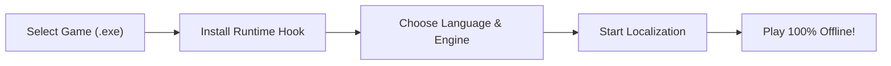

# UnityLocalizer 🎮🌐

[](LICENSE)
[](https://www.python.org/)
[](https://github.com)
[](https://www.riverbankcomputing.com/software/pyqt/)
[](https://github.com/YourUsername/UnityLocalizer/actions)

> **High-performance, automated, ahead-of-time (AOT) translation and patch deployment suite for games built on the Unity engine.**

Translate any Unity game into your native language with zero gameplay lag, complete offline runtime playback, and automatic TextMeshPro "tofu" (missing glyph) font resolution.

---

[📖 English Description](#-key-features) | [🇹🇷 Türkçe Açıklama](#-t%C3%BCrk%C3%A7e-%C3%B6zet)

---

## ⚡ Why UnityLocalizer?

Most real-time machine translation tools hook into games and translate text line-by-line while you play. This causes **network latency, stuttering, broken formatting, and missing font characters (□ squares)**. 

**UnityLocalizer does things differently:**
- 🚀 **100% Offline In-Game Performance:** Translates your game **ahead-of-time (AOT)**. Once localized, play completely offline with zero FPS drop or lag.
- 🛡️ **Zero Crash Risk:** Uses read-only binary extraction (`UnityPy`) instead of dangerous binary asset repacking that breaks modern Unity LZ4/LZMA checksums.
- 🔡 **Automatic Font Provisioning:** Solves the missing glyph crisis by deploying version-matched ArialUnicode SDF fallback font bundles for Unity 5.5 through 6000.
- 🧩 **AST Syntax Guard:** Protects RichText tags (`<color>`, `<size>`, `<sprite>`), NGUI BBCode, and C# formatting patterns (`{0}`, `{playerName}`, `\n`, `%s`) so game scripts never crash.
- 📦 **One-Click Standalone Patch Packages:** Export full, shareable offline patch `.zip` distributions with bilingual install and restore `.bat` scripts.

---

## 🎮 Quick Start Guide (For Gamers & Translators)

You don't need any modding experience to localize a Unity game:



### 3 Easy Steps:

1. **Select Your Game:**
   - Launch **UnityLocalizer**.
   - Drag & drop or browse to your game's root folder or `.exe`.
   - The profiler will instantly detect the Unity engine version, architecture (Mono vs. IL2CPP, 32-bit vs. 64-bit), and narrative frameworks.
2. **Install Runtime & Font (One-Click):**
   - Click the **"Install Hooks"** button in the Toolbox or Dashboard banner.
   - UnityLocalizer automatically provisions the correct BepInEx runtime and matching TextMeshPro fallback font bundle.
3. **Translate & Play:**
   - Select your desired **Target Language** (e.g., Turkish, Spanish, German, French, etc.) and your preferred **Translation Engine**.
   - Click **"Start Localization"**.
   - Once completed, click **Launch Game** and enjoy!

---

## ✨ Core Features

| Feature | Description |
| :--- | :--- |
| **Deep Multi-Channel Extraction** | Extracts player-visible text from `.assets`, `level*`, `data.unity3d`, Mono assemblies (`Assembly-CSharp.dll` `#US` stream), IL2CPP `global-metadata.dat`, and loose `StreamingAssets` (JSON, CSV, TSV, XML, TXT, Yarn Spinner, Inkle Ink, Naninovel). |
| **8 Translation Engines** | Multi-mirror Google Translate (13 mirrors with Lingva fallback), keyless Bing, DeepL (Free & Pro), LibreTranslate, Google Gemini (`google-genai`), OpenAI, DeepSeek, and Local LLMs (Ollama, LM Studio). |
| **Dynamic Regex Dictionaries** | Automatically synthesizes `.NET` regex dictionary entries (`r:"^Gold: (.*?)$"="Altın: ${1}"`) for runtime-formatted strings like `Gold: {0}`. |
| **Interactive Review Editor** | Filter, review, and manually tweak translated lines with real-time Syntax Guard validation before shipping. |
| **Glossary & Translation Memory** | Define custom term replacements (e.g., `Health Potion → Can İksiri`) and import existing TMX, CSV, TSV, or JSON translation memories with fuzzy matching. |
| **Full RTL Language Engine** | Native static shaping and tag-safe bidirectional reordering for Arabic, Persian, Hebrew, Urdu, Pashto, Sorani, Sindhi, Uyghur, Yiddish, and Dhivehi. |
| **Cyberpunk Glassmorphic UI** | Responsive, hardware-accelerated PyQt6 + QML interface localized into 12 languages with real-time log streaming and instant settings persistence. |

---

## 🛠️ Supported Translation Engines

| Engine | Type | API Key Required? | Concurrency / Features |
| :--- | :--- | :---: | :--- |
| **Google Translate** | Web Scraper | ❌ No | 13 endpoints, `batchexecute`, IP circuit breaker, Lingva fallback |
| **Microsoft Bing** | Web Scraper | ❌ No | Keyless Edge service with exponential backoff & Google failover |
| **DeepL** | Official API | ✔️ Yes (Free/Pro) | Formality control (`formal`, `informal`, `default`) |
| **LibreTranslate** | Self-Hosted / Public | Optional | Open-source API compatibility with request pacing |
| **Google Gemini** | AI (LLM) | ✔️ Yes | Official `google-genai` SDK, XML structured batching, safety filters |
| **OpenAI / OpenRouter** | AI (LLM) | ✔️ Yes | GPT-4o, custom OpenAI-compatible endpoints, XML batching |
| **DeepSeek** | AI (LLM) | ✔️ Yes | DeepSeek Chat & Reasoner with specialized system prompting |
| **Local LLM** | Self-Hosted | ❌ No | Ollama & LM Studio integration running 100% locally on your GPU |

---

## 📦 Standalone Patch Exporter

Want to share your localized game with friends or the community?
1. Open the **Dashboard** and click **Export Patch Package**.
2. UnityLocalizer generates a clean, standalone distribution in `%APPDATA%\UnityLocalizer\Patches\`:
   - `Patches/<Game>_<Language>_Patch.zip`
   - Includes automatic installer & uninstaller scripts: `Install_Patch.bat` (`Yama_Kur.bat`) and `Uninstall_Patch.bat` (`Yama_Kaldir.bat`).
3. Players simply extract the ZIP into the game folder, double-click **Install**, and the patch automatically backs up original game files (`.ul_orig`) and installs the translation. Running **Uninstall** restores the pristine vanilla state!

---

## 🩺 Troubleshooting & FAQ

<details>
<summary><b>Missing letters or box squares (□) appearing in-game?</b></summary>

This happens when the game's TextMeshPro font lacks glyphs for your language. UnityLocalizer solves this automatically by deploying ArialUnicode SDF. 

If you are playing a heavily stripped IL2CPP game that blocks AssetBundle loading:
1. Open **Settings** in UnityLocalizer.
2. Under **Runtime & Font**, find **TextMeshPro System Font Override**.
3. Type the name of a standard Windows font (e.g. `Arial` or `Segoe UI`).
4. Re-run or restart the game.
</details>

<details>
<summary><b>How do I toggle translations on/off while playing?</b></summary>

- `ALT + T`: Toggle translation on/off in real-time.
- `ALT + R`: Reload translation dictionaries without restarting the game.
</details>

<details>
<summary><b>Is Linux / Steam Deck / macOS supported?</b></summary>

- **Current Status (v0.1.0):** Native focus is on **Windows PC games** (`.exe`).
- **Steam Deck & Linux (Proton / Wine):** Fully playable! Since Steam Deck runs Windows Unity games through Proton/Wine, any game patched with UnityLocalizer can be played on Steam Deck. Simply add `WINEDLLOVERRIDES="winhttp=n,b" %command%` to your Steam game launch options so Proton loads the BepInEx proxy.
- **Roadmap:** Native Linux (`.x86_64` / SteamOS) and macOS support are planned for upcoming releases (v0.2.0) based on community feedback.
</details>

<details>
<summary><b>Does this work with pirated or modded games?</b></summary>

UnityLocalizer works with any valid Unity game folder containing a game executable and a `<GameName>_Data` folder (Steam, GOG, Epic Games, itch.io, or standalone releases). Existing BepInEx mods are preserved and backed up cleanly.
</details>

---

## 🇹🇷 Türkçe Özet

**UnityLocalizer**, Unity motoruyla yapılmış oyunları tek tıkla Türkçeleştirmek için tasarlanmış bağımsız, açık kaynaklı bir masaüstü otomasyonudur.

- **Kutu Kutu (□) Font Hatasına Son:** Unity 5.5 ile Unity 6000 arasındaki tüm sürümler için TextMeshPro Türkçe uyumlu font paketini otomatik olarak kurar.
- **Oyun İçi Sıfır Kasma & %100 Çevrimdışı:** Oyun oynanırken canlı çeviri yapıp FPS düşürmez; metinleri önceden çevirip oyuna kalıcı ve internetsiz olarak entegre eder.
- **Tek Tıkla Yama Paketi:** Çevirdiğiniz oyunu arkadaşlarınızla paylaşabilmeniz için çift tıkla kurulan ve kaldırılabilen bağımsız Türkçe yama `.zip` paketleri oluşturur.
- **Gelişmiş Yapay Zekâ ve Motor Desteği:** Google, Bing, DeepL, Google Gemini, OpenAI, DeepSeek veya kendi bilgisayarınızda çalışan yerel yapay zekâ (Ollama / LM Studio) ile çeviri yapabilirsiniz.
- **Platform & Steam Deck Durumu:** v0.1.0 sürümü Windows oyunlarını hedefler. Steam Deck ve Linux kullanıcıları, Proton/Wine altında çalışan oyunlarda Steam başlatma seçeneğine `WINEDLLOVERRIDES="winhttp=n,b" %command%` ekleyerek yamaları hemen kullanabilir. Native Linux/SteamOS desteği ise yol haritasındadır (v0.2.0).

---

## 💻 Building from Source

### Prerequisites
- Python 3.10, 3.12, or 3.14 (64-bit recommended)
- Windows 10/11

```powershell
# 1. Clone the repository
git clone https://github.com/YourUsername/UnityLocalizer.git
cd UnityLocalizer

# 2. Install dependencies
pip install -r requirements.txt

# 3. Launch the application
python run.py

# Run tests and dependency validation
python -m pytest -q
python run.py --self-check

# Build standalone Windows executable (.exe)
python build.py
```

---

## 📜 License

This project is licensed under the **GNU General Public License v3.0 (GPL-3.0)**. See the [LICENSE](LICENSE) file for details.
